# AWS High Availability Architecture

A highly available web application deployed on AWS using Amazon VPC, EC2, and an Application Load Balancer (ALB) across multiple Availability Zones.

## 🚀 Project Overview

This project demonstrates the deployment of a highly available web application using AWS networking, compute, and load-balancing services.

Two Amazon EC2 web servers are deployed across separate Availability Zones behind an internet-facing Application Load Balancer. The ALB performs health checks and distributes incoming HTTP requests across healthy instances, helping maintain application availability during an instance failure.

## 🏗️ Architecture

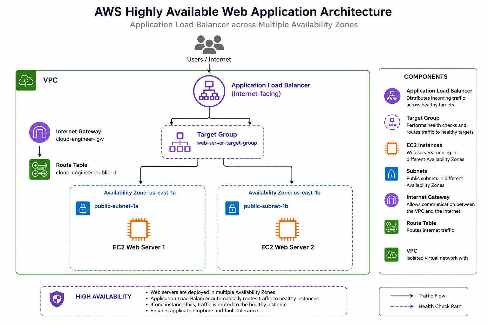

The architecture uses two EC2 instances in separate Availability Zones, connected to an Application Load Balancer through a target group. Public subnets, route tables, and an Internet Gateway provide network connectivity, while security groups control inbound traffic.

## ☁️ AWS Services Used

- **Amazon VPC** — Provides an isolated virtual network.
- **Amazon EC2** — Hosts the web application on two instances.
- **Application Load Balancer (ALB)** — Distributes incoming HTTP requests across healthy targets.
- **Target Groups** — Register EC2 instances and configure health checks.
- **Internet Gateway** — Enables Internet connectivity for resources in public subnets.
- **Route Tables** — Define traffic routing within the VPC.
- **Security Groups** — Control inbound and outbound traffic.
- **Availability Zones** — Provide infrastructure redundancy across separate zones.

## 📸 Project Screenshots

### 1. VPC Configuration

Shows the custom `cloud-engineer-vpc` with the CIDR block `10.0.0.0/16`, providing the isolated network environment for the application.

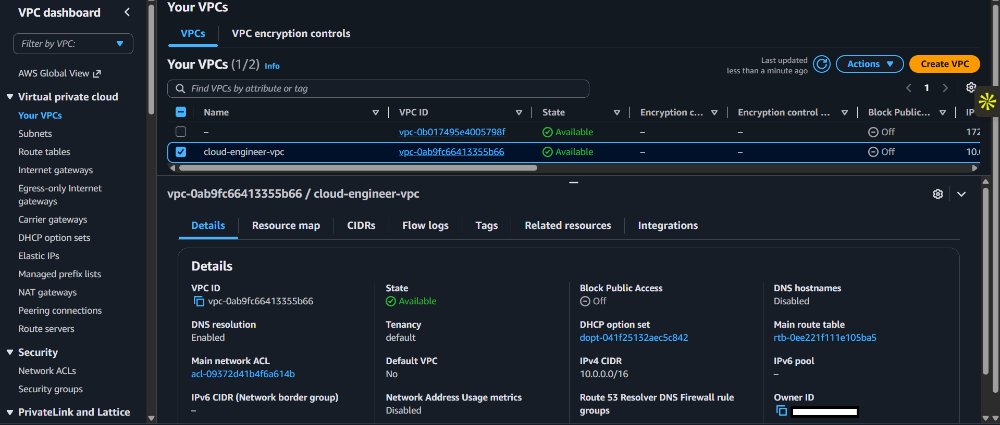

### 2. Subnets Across Availability Zones

Shows the `public-subnet-1a` and `public-subnet-1b` subnets deployed across separate Availability Zones to support high availability.

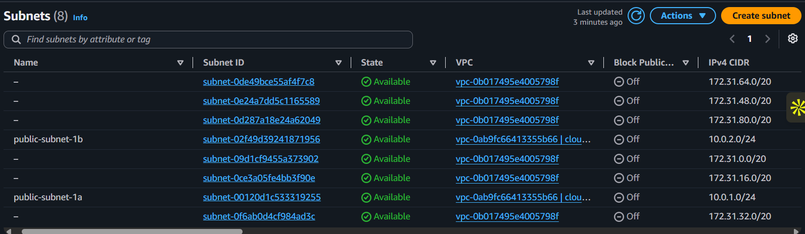

### 3. Internet Gateway

Shows the Internet Gateway attached to the VPC, enabling Internet connectivity for resources in the public subnets when their routing and security configurations permit it.

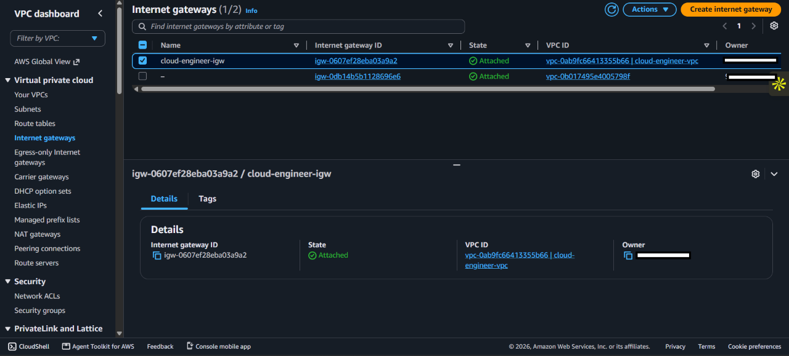

### 4. Route Table

Shows the public route table configured with a default route (`0.0.0.0/0`) through the Internet Gateway, allowing eligible resources in the associated public subnets to communicate with the Internet.

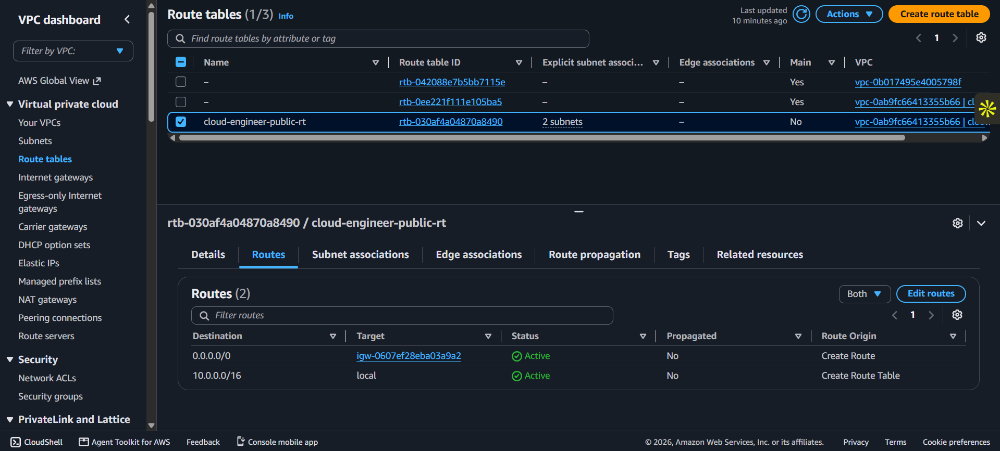

### 5. ALB Security Group

Shows the security group associated with the Application Load Balancer, allowing inbound HTTP traffic on port 80 from the Internet.

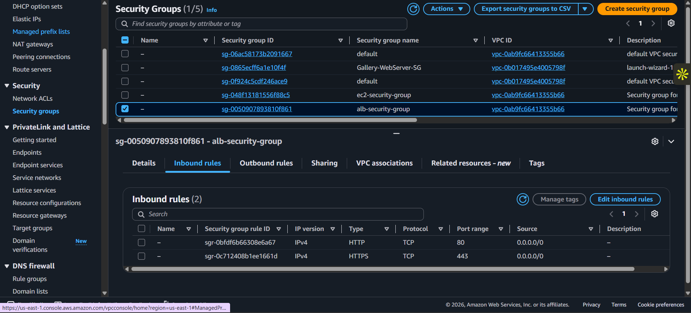

### 6. EC2 Security Group

Shows the security group rules for the EC2 instances, permitting SSH access from the administrator's IP address and HTTP traffic from the ALB security group.

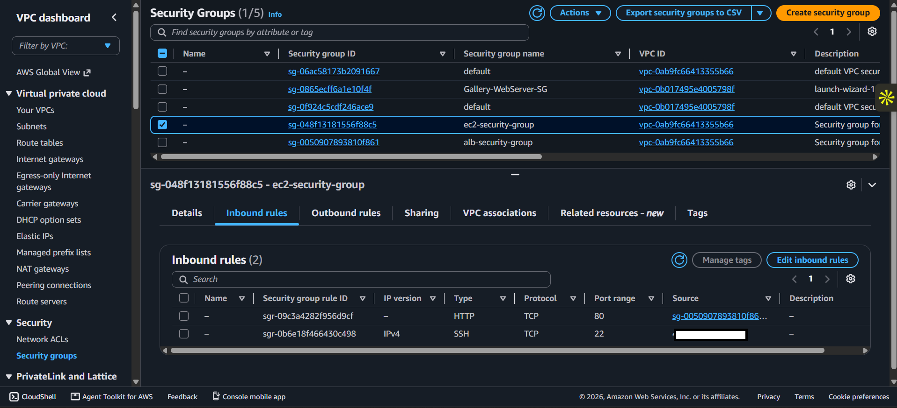

### 7. EC2 Instances

Shows the two Amazon EC2 web servers running in separate Availability Zones, providing redundancy for the application.

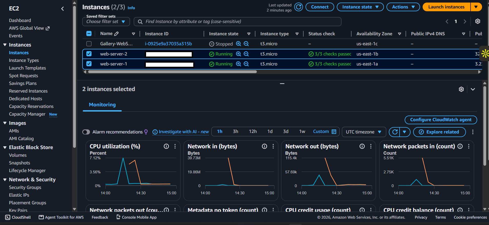

### 8. Target Group

Shows the target group containing both EC2 web servers. The target group performs health checks and provides the ALB with the health status of registered targets.

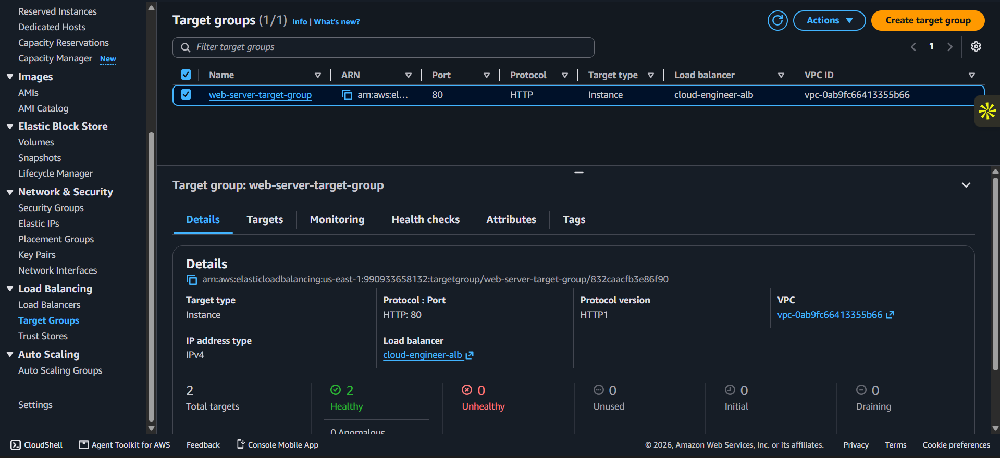

### 9. Application Load Balancer

Shows the internet-facing Application Load Balancer configured to distribute incoming HTTP requests across the registered EC2 instances.

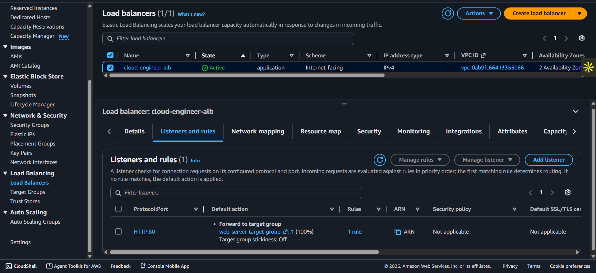

### 10. Application Access Through the ALB

Shows the web application accessed through the Application Load Balancer's DNS name, confirming that requests are successfully forwarded to a web server.

### 11. High Availability Test — Unhealthy Target

Shows the target group after one EC2 instance was stopped, causing that target to become unhealthy while the other instance remained healthy.

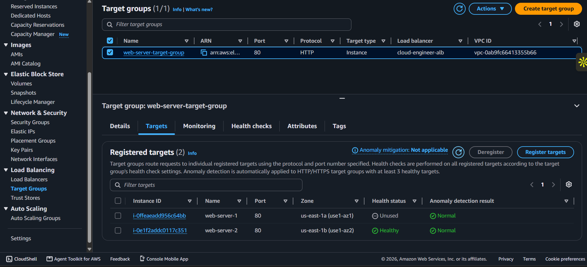

### 12. High Availability Test — Application Remains Accessible

Shows that the application remains accessible through the ALB after one EC2 instance becomes unhealthy, with requests continuing to be served by the healthy instance.

### 13. Recovery — Healthy Targets Restored

Shows both EC2 instances returning to a healthy state after the stopped instance was restarted and passed its target group health checks.

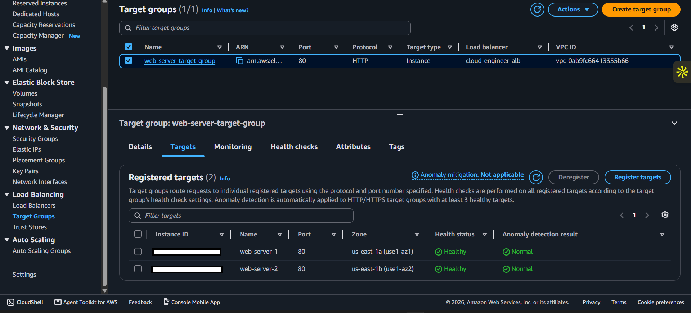

## ✅ Key Learnings

- Configured a custom VPC with public subnets across multiple Availability Zones.
- Implemented Internet routing using an Internet Gateway and route tables.
- Applied security group rules to control access to the ALB and EC2 instances.
- Configured an Application Load Balancer with a target group and health checks.
- Tested instance failure and verified that the application remained accessible through the healthy instance.
- Observed target recovery after restarting an EC2 instance.

## 🎯 Project Outcome

Successfully deployed and tested a multi-AZ web application architecture using core AWS networking and compute services. The project demonstrates practical experience with load balancing, health checks, security group configuration, and basic high-availability testing.
